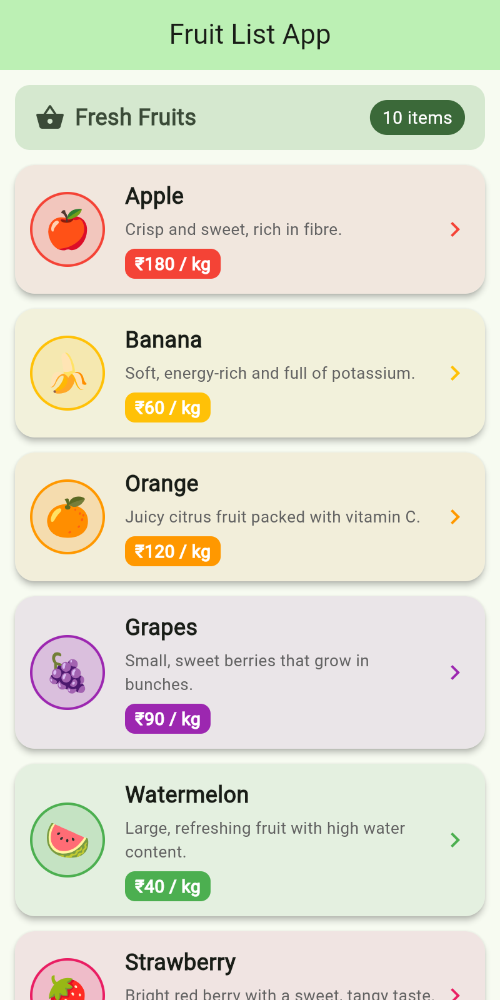
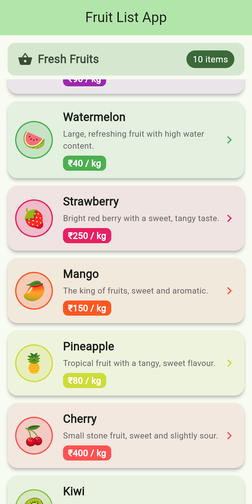
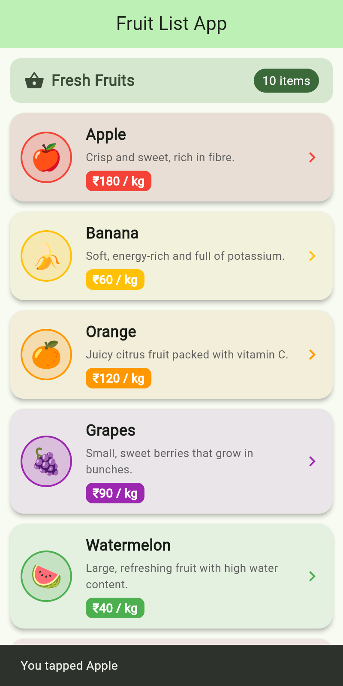

# Fruit List App – Flutter Lab Ex. 1

**24CS2016 – Building Applications using Flutter** · URK23CS5014

**Experiment 1 – Working with Widgets and Layouts:** a Flutter app that displays a list of
fruit items using `Row`, `Column`, `Container`, `Card` and `ListView.builder`, organised with
reusable custom widgets.

## Structure
```
lib/
  main.dart                      # entry point, MaterialApp (Material 3)
  models/fruit.dart              # Fruit model
  data/fruit_data.dart           # list of fruits
  screens/fruit_list_screen.dart # Scaffold + AppBar + ListView.builder
  widgets/fruit_card.dart        # Card > Container > Row
  widgets/fruit_avatar.dart      # circular emoji avatar
  widgets/fruit_info.dart        # Column: name, description, price
  widgets/section_header.dart    # header with fruit count
```

## Run
```
flutter pub get
flutter run
```

## Output
| Launch | Scrolled | Tapped |
|---|---|---|
|  |  |  |
